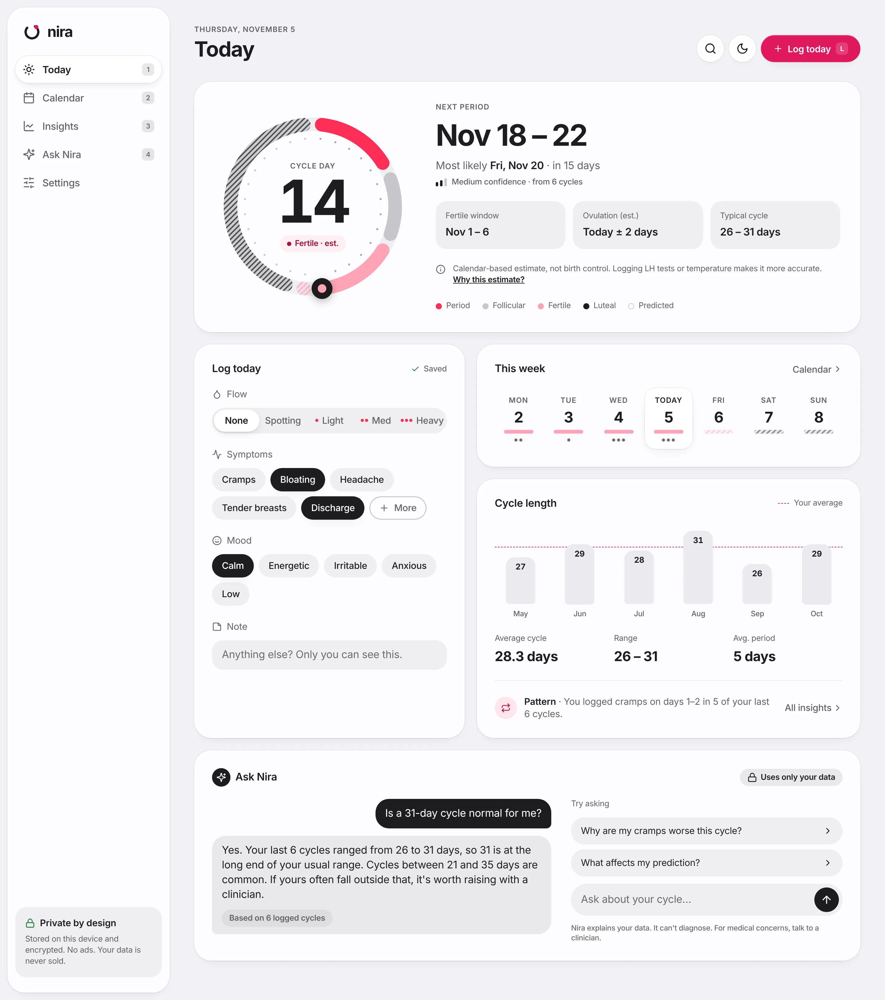
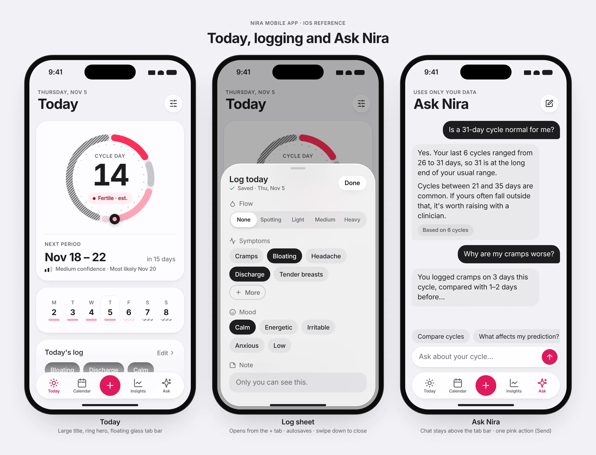

# nira
Nira is a free, privacy‑first period and cycle tracking app with an AI assistant, focused on fast logging, honest predictions, and a better experience than traditional femtech apps.

## Design

Nira's design language for the web and mobile apps is in [`design/`](design/DESIGN.md).
Reference screens for every page are listed in [DESIGN.md §14](design/DESIGN.md#14-screen-inventory-reference-designs).

